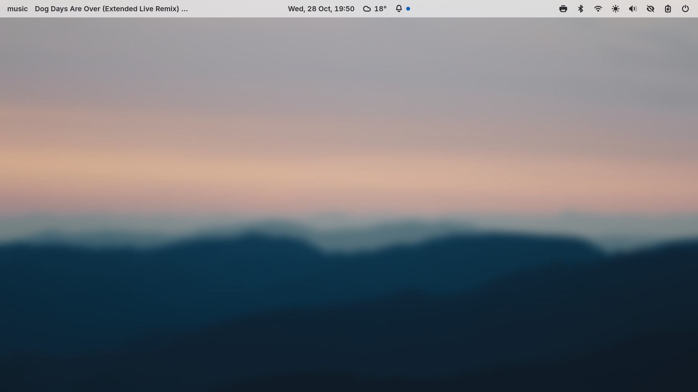
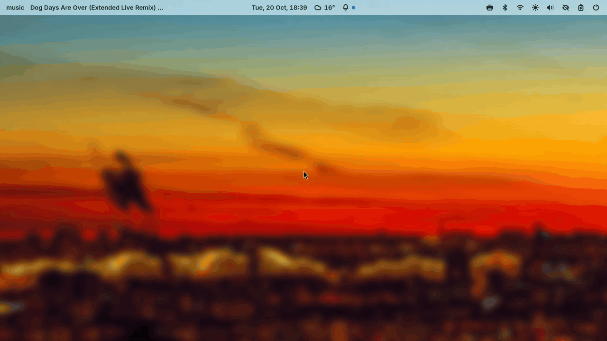
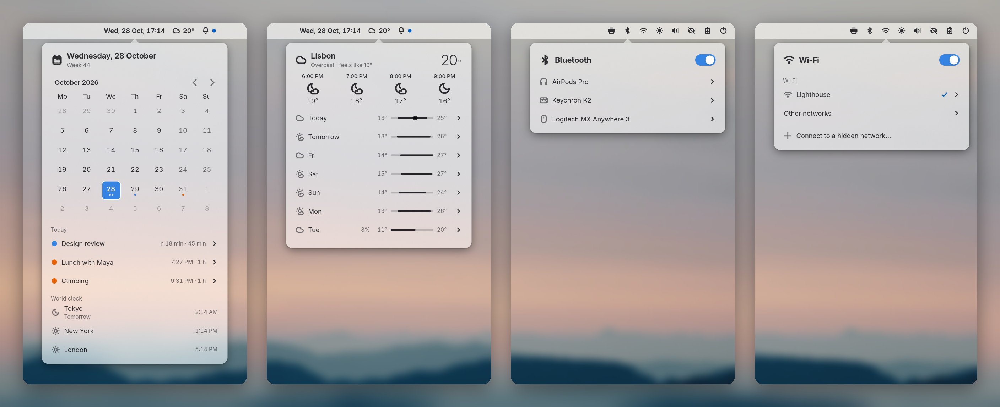

# glimpse

A desktop shell for Wayland: a panel, a wallpaper and a lock screen, built with GTK4 and
libadwaita.

<picture>
  <source media="(prefers-color-scheme: dark)" srcset="docs/screenshots/shell-dark.png">
  
</picture>

## Demo

<picture>
  <source media="(prefers-color-scheme: dark)" srcset="docs/screenshots/demo-dark.gif">
  
</picture>

Watch it in full quality: [light](website/public/video/demo.mp4), [dark](website/public/video/demo-dark.mp4).

<picture>
  <source media="(prefers-color-scheme: dark)" srcset="docs/screenshots/applets-dark.png">
  
</picture>

## Installation

On Arch Linux, install the package from the AUR:

```sh
yay -S glimpse-desktop-bin
```

On Debian 14, Ubuntu 26.04, Fedora 44 or openSUSE Tumbleweed and newer, the install script
downloads the latest release as a `.deb` or `.rpm`, checks it against the published checksums and
installs it:

```sh
curl -fsSL https://raw.githubusercontent.com/alex-oleshkevich/glimpse/master/install.sh | bash
```

On NixOS, import the flake's module and start `glimpse-session.target` from your compositor, as
under [Start the shell](#start-the-shell):

```nix
{
  inputs.glimpse.url = "github:alex-oleshkevich/glimpse";
  outputs = { nixpkgs, glimpse, ... }: {
    nixosConfigurations.host = nixpkgs.lib.nixosSystem {
      modules = [ glimpse.nixosModules.default { services.glimpse.enable = true; } ];
    };
  };
}
```

To build from source you need Rust 1.95 or newer, `just`, `blueprint-compiler`, gettext and clang,
plus the development files for GTK4, libadwaita, gtk4-layer-shell, PulseAudio, PipeWire, PAM and udev. Then:

```sh
just build-release-binaries build-translations
sudo GLIMPSE_BINARIES="$(just --evaluate binaries)" scripts/install.sh
```

### Start the shell

glimpse runs as systemd user services under `glimpse-session.target`, which follows
`graphical-session.target`. If your session starts that target (niri's `niri-session`, uwsm), enable
the shell target once:

```sh
systemctl --user enable --now glimpse-session.target
```

Otherwise (plain Hyprland, NixOS) start it with the compositor and stop it on exit. In `hyprland.lua`:

```lua
hl.on("hyprland.start", function()
    hl.exec_cmd("systemctl --user start glimpse-session.target")
end)
hl.on("hyprland.shutdown", function()
    hl.exec_cmd("systemctl --user --job-mode=replace-irreversibly stop glimpse-session.target")
end)
```

In a legacy `hyprland.conf`:

```ini
exec-once = systemctl --user start glimpse-session.target
exec-shutdown = systemctl --user --job-mode=replace-irreversibly stop glimpse-session.target
```

The configuration lives in `~/.config/glimpse/`: `config.toml` for settings and `panel.toml` for the
panel layout. Every setting and its default is listed, with comments, in
[`data/config.commented.toml`](data/config.commented.toml) and
[`data/panel.commented.toml`](data/panel.commented.toml).

## Documentation

The [glimpse documentation](https://alex-oleshkevich.github.io/glimpse/) covers what the shell adds
to a bare compositor, its configuration, applets, theming and the installed files. Working on
glimpse itself: [AGENTS.md](AGENTS.md) and [`docs/handbook.md`](docs/handbook.md).

## Credits

glimpse is built on [GTK4](https://gtk.org), [libadwaita](https://gnome.pages.gitlab.gnome.org/libadwaita/),
[gtk4-layer-shell](https://github.com/wmww/gtk4-layer-shell), [relm4](https://relm4.org),
[zbus](https://github.com/dbus2/zbus) and [tokio](https://tokio.rs). Weather and geocoding come from
[Open-Meteo](https://open-meteo.com), location from [GeoClue](https://gitlab.freedesktop.org/geoclue/geoclue),
and icons from the [Adwaita](https://gitlab.gnome.org/GNOME/adwaita-icon-theme) icon theme.

glimpse is released under the [BSD 3-Clause license](LICENSE).
