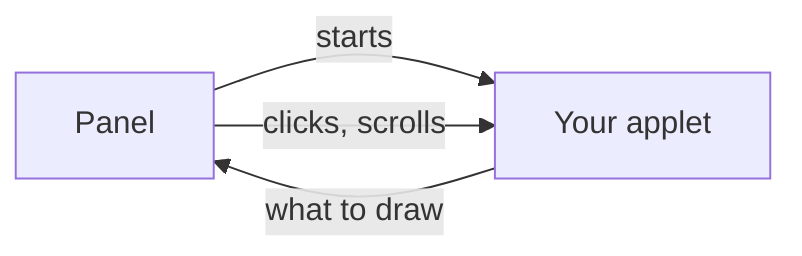

# Build a todo applet

Build the shipped todo example in five stages: create a project, show a task, add tasks, add dates and controls, then save the list. You'll need a running glimpse panel, its installed SDK template, Node.js 22 or newer, and npm.

## How it connects

The panel starts your applet as a program and talks to it over a socket. You send what to draw, and the panel sends back clicks and scrolls. The SDK does this for you.



Details are in [how the panel hosts applets](/developers/exec-applets).

## 1. Create and run the project

Run:

```sh
glimpsectl applet new
```

Answer the prompts with these values:

| Prompt | Enter |
| --- | --- |
| Applet id | `me.aresa.GlimpseTodo` |
| Name | `Todo` |
| Description | `A list of things to do` |
| Icon | `view-list-symbolic` |
| Directory | `glimpse-todo` |

Use a new or empty directory. The id must not already be installed. The command creates `index.tsx`, `package.json`, `tsconfig.json`, `config.toml`, `README.md`, and `me.aresa.GlimpseTodo.desktop`.

```sh
cd glimpse-todo
npm install
glimpsectl applet run --dev .
```

Leave that terminal open. A Todo chip appears in your panel; click it to see an "It works" row. You don't need to install the desktop entry or change your panel configuration for this development run.

The generated TypeScript configuration uses `jsxImportSource: "glimpse-sdk"`. Keep that setting and the generated package scripts. Saving source restarts the applet and rebuilds it; stderr appears in this terminal.

## 2. Show a task and an open count

Replace all of `index.tsx` with:

```tsx
import {
  Indicator, Popover, run, Section, ToggleRow, useState,
} from "glimpse-sdk";

function Todo() {
  const [done, setDone] = useState(false);
  return (
    <>
      <Indicator icon="view-list-symbolic" tooltip="Todo" badge={done ? "0" : "1"}>
        Todo
      </Indicator>
      <Popover icon="view-list-symbolic" title="Todo">
        <Section title="Todo" count={done ? "0" : "1"}>
          <ToggleRow title="Buy groceries" control="check" active={done} onToggle={setDone} />
        </Section>
      </Popover>
    </>
  );
}

await run(<Todo />);
```

Save, then click Todo. The badge shows one open task. Click the "Buy groceries" row and the badge becomes zero. `useState` keeps the done state while this process runs. `ToggleRow` with `control="check"` shows a check mark at the end of the row only while the task is done.

## 3. Add tasks from an entry

Replace all of `index.tsx` again:

```tsx
import {
  Entry, Indicator, Popover, run, Section, ToggleRow, useState,
} from "glimpse-sdk";

type Item = { id: string; title: string; done: boolean };

function Todo() {
  const [items, setItems] = useState<Item[]>([]);
  const [draft, setDraft] = useState("");
  const open = items.filter((item) => !item.done);
  return (
    <>
      <Indicator icon="view-list-symbolic" tooltip="Todo" badge={String(open.length)}>
        Todo
      </Indicator>
      <Popover icon="view-list-symbolic" title="Todo">
        <Section title="Todo" count={String(open.length)}>
          {items.map((item) => (
            <ToggleRow
              key={item.id}
              title={item.title}
              control="check"
              active={item.done}
              onToggle={(done) => setItems(items.map((candidate) =>
                candidate.id === item.id ? { ...candidate, done } : candidate
              ))}
            />
          ))}
        </Section>
        <Entry
          placeholder="Add a task"
          value={draft}
          onChange={setDraft}
          onSubmit={(value) => {
            const title = value.trim();
            if (title === "") return;
            setItems([...items, { id: crypto.randomUUID(), title, done: false }]);
            setDraft("");
          }}
        />
      </Popover>
    </>
  );
}

await run(<Todo />);
```

The list starts empty after the source restart. Open Todo, type "Buy groceries" in the entry, and press Enter. The row appears and the entry clears. Add "Book a dentist appointment", then check either row to reduce the open count.

The entry is controlled by `value` and `onChange`; `onSubmit` receives its text when you press Enter. Each task gets a stable id for its React key.

## 4. Add dates, options, and list controls

Replace `index.tsx` with this version:

```tsx
import {
  Button,
  copy,
  Entry,
  Indicator,
  notify,
  Popover,
  run,
  Section,
  ToggleRow,
  useOptions,
  usePlacement,
  useState,
} from "glimpse-sdk";

type Item = {
  id: string;
  title: string;
  done: boolean;
  due: string | null;
};

function today(): string {
  const now = new Date();
  const month = String(now.getMonth() + 1).padStart(2, "0");
  const day = String(now.getDate()).padStart(2, "0");
  return `${now.getFullYear()}-${month}-${day}`;
}

function splitDraft(text: string): { title: string; due: string | null } {
  const trimmed = text.trim();
  const match = /^(.*\S)\s+(\d{4}-\d{2}-\d{2})$/.exec(trimmed);
  if (!match) return { title: trimmed, due: null };
  return { title: match[1], due: match[2] };
}

function Todo() {
  const options = useOptions();
  const placement = usePlacement();
  const configured = options.title;
  const title = typeof configured === "string" && configured.trim() !== ""
    ? configured
    : "Todo";
  const [items, setItems] = useState<Item[]>([]);
  const [draft, setDraft] = useState("");
  const [showDone, setShowDone] = useState(false);

  const open = items.filter((item) => !item.done);
  const day = today();
  const overdue = open.some((item) => item.due !== null && item.due < day);
  const vertical = placement?.orientation === "vertical";
  const visible = showDone ? items : open;

  return (
    <>
      <Indicator
        icon="view-list-symbolic"
        tooltip={title}
        badge={String(open.length)}
        dot={overdue ? "#e01b24" : undefined}
      >
        {vertical ? null : title}
      </Indicator>
      <Popover
        icon="view-list-symbolic"
        title={title}
        subtitle={`${open.length} open`}
      >
        <Section title={title} count={String(open.length)}>
          {visible.map((item) => (
            <ToggleRow
              key={item.id}
              title={item.title}
              subtitle={item.due ?? undefined}
              control="check"
              active={item.done}
              onToggle={() => {
                setItems(items.map((candidate) =>
                  candidate.id === item.id
                    ? { ...candidate, done: !candidate.done }
                    : candidate
                ));
              }}
            />
          ))}
        </Section>
        <Entry
          placeholder="Add a task"
          value={draft}
          onChange={setDraft}
          onSubmit={(value) => {
            const parsed = splitDraft(value);
            if (parsed.title === "") return;
            setItems([
              ...items,
              {
                id: crypto.randomUUID(),
                title: parsed.title,
                done: false,
                due: parsed.due,
              },
            ]);
            setDraft("");
          }}
        />
        <ToggleRow title="Show done" active={showDone} onToggle={setShowDone} />
        <Button
          onClick={() => {
            copy(
              items.map((
                item,
              ) => (item.due ? `${item.title} ${item.due}` : item.title))
                .join(
                  "\n",
                ),
            );
          }}
        >
          Copy all
        </Button>
      </Popover>
    </>
  );
}

await run(<Todo />);
```

Save and add "Renew library books 2000-01-01". The date appears below the task and the chip gains a red dot because an open item is overdue. Check the task to hide it, then enable "Show done" to see it again. "Copy all" copies every task, including completed tasks and their dates.

Change the project's local `config.toml` to:

```toml
options = { title = "Groceries" }
```

Save it. The chip and popover title become "Groceries" without restarting the process. `useOptions` reads this title, and `usePlacement` lets the same component omit the chip's text on a vertical panel while keeping its badge.

## 5. Keep the list between restarts

Replace `index.tsx` with the finished example below. This source edit starts the persistent version with an empty list; add your tasks again after saving.

```tsx
import { readFileSync, renameSync, rmSync, writeFileSync } from "node:fs";
import { join } from "node:path";
import {
  Button,
  copy,
  Entry,
  Indicator,
  notify,
  Popover,
  run,
  Section,
  ToggleRow,
  useEffect,
  useOptions,
  usePlacement,
  useState,
  useStateDir,
} from "glimpse-sdk";

type Item = {
  id: string;
  title: string;
  done: boolean;
  due: string | null;
};

function loadItems(stateDir: string): { items: Item[]; failed: boolean } {
  if (!stateDir) return { items: [], failed: false };
  try {
    const raw = readFileSync(join(stateDir, "todo.json"), "utf8");
    const parsed: unknown = JSON.parse(raw);
    if (!Array.isArray(parsed) || !parsed.every(isItem)) {
      return { items: [], failed: true };
    }
    return { items: parsed, failed: false };
  } catch (error) {
    if ((error as NodeJS.ErrnoException).code === "ENOENT") {
      return { items: [], failed: false };
    }
    return { items: [], failed: true };
  }
}

function isItem(value: unknown): value is Item {
  if (typeof value !== "object" || value === null) return false;
  const item = value as Record<string, unknown>;
  return typeof item.id === "string" &&
    typeof item.title === "string" &&
    typeof item.done === "boolean" &&
    (item.due === null || typeof item.due === "string");
}

function today(): string {
  const now = new Date();
  const month = String(now.getMonth() + 1).padStart(2, "0");
  const day = String(now.getDate()).padStart(2, "0");
  return `${now.getFullYear()}-${month}-${day}`;
}

function splitDraft(text: string): { title: string; due: string | null } {
  const trimmed = text.trim();
  const match = /^(.*\S)\s+(\d{4}-\d{2}-\d{2})$/.exec(trimmed);
  if (!match) return { title: trimmed, due: null };
  return { title: match[1], due: match[2] };
}

function Todo() {
  const stateDir = useStateDir();
  const options = useOptions();
  const placement = usePlacement();
  const configured = options.title;
  const title = typeof configured === "string" && configured.trim() !== ""
    ? configured
    : "Todo";
  const [loaded] = useState(() => loadItems(stateDir));
  const [items, setItems] = useState<Item[]>(loaded.items);
  const [draft, setDraft] = useState("");
  const [showDone, setShowDone] = useState(false);

  useEffect(() => {
    if (!stateDir || loaded.failed && items === loaded.items) return;
    const target = join(stateDir, "todo.json");
    const temp = `${target}.${process.pid}.tmp`;
    try {
      writeFileSync(temp, JSON.stringify(items));
      renameSync(temp, target);
    } catch (error) {
      rmSync(temp, { force: true });
      notify({ summary: "Could not save Todo items", body: String(error) });
    }
  }, [items, stateDir, loaded]);

  const open = items.filter((item) => !item.done);
  const day = today();
  const overdue = open.some((item) => item.due !== null && item.due < day);
  const vertical = placement?.orientation === "vertical";
  const visible = showDone ? items : open;

  return (
    <>
      <Indicator
        icon="view-list-symbolic"
        tooltip={title}
        badge={String(open.length)}
        dot={overdue ? "#e01b24" : undefined}
      >
        {vertical ? null : title}
      </Indicator>
      <Popover
        icon="view-list-symbolic"
        title={title}
        subtitle={`${open.length} open`}
      >
        <Section title={title} count={String(open.length)}>
          {visible.map((item) => (
            <ToggleRow
              key={item.id}
              title={item.title}
              subtitle={item.due ?? undefined}
              control="check"
              active={item.done}
              onToggle={() => {
                setItems(items.map((candidate) =>
                  candidate.id === item.id
                    ? { ...candidate, done: !candidate.done }
                    : candidate
                ));
              }}
            />
          ))}
        </Section>
        <Entry
          placeholder="Add a task"
          value={draft}
          onChange={setDraft}
          onSubmit={(value) => {
            const parsed = splitDraft(value);
            if (parsed.title === "") return;
            setItems([
              ...items,
              {
                id: crypto.randomUUID(),
                title: parsed.title,
                done: false,
                due: parsed.due,
              },
            ]);
            setDraft("");
          }}
        />
        <ToggleRow title="Show done" active={showDone} onToggle={setShowDone} />
        <Button
          onClick={() => {
            copy(
              items.map((
                item,
              ) => (item.due ? `${item.title} ${item.due}` : item.title))
                .join(
                  "\n",
                ),
            );
          }}
        >
          Copy all
        </Button>
      </Popover>
    </>
  );
}

await run(<Todo />);
```

Add a task, then type `r` and Enter in the development terminal. Open the popover again: the task is still there.

`useStateDir()` supplies the persistent directory. This version validates the saved JSON before using it and writes through a temporary file before replacing `todo.json`. If loading fails, it leaves the saved file alone until you edit the list. A failed save requests a notification.

Run the generated type check in another terminal from the project directory:

```sh
npm run check
```

Press Ctrl-C in the development terminal to detach. To keep the applet on your panel, follow [Install and share an applet](/applets/exec/share).

