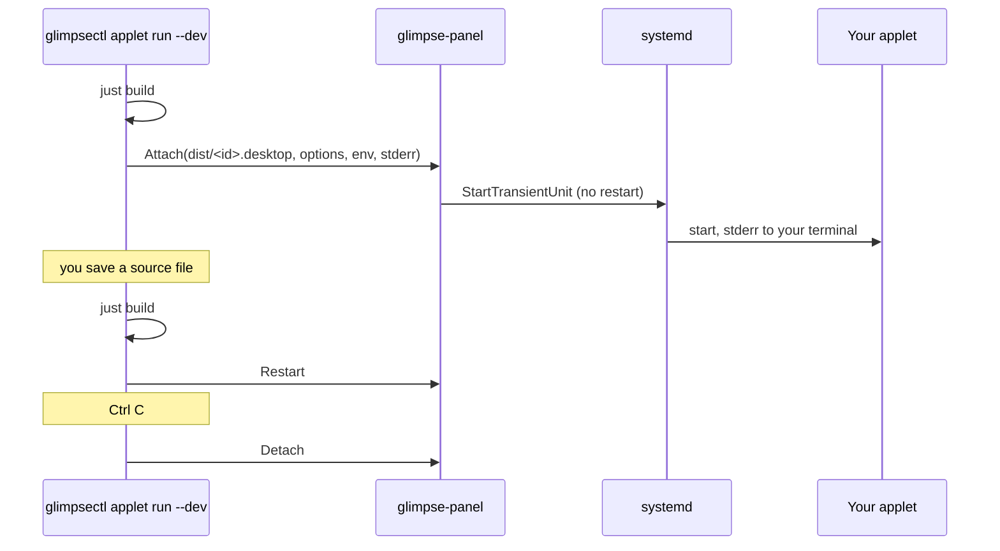

# How development mode works

`glimpsectl applet run` puts your working copy of an applet into the running panel without touching
your config. Its logs go to your terminal, and Ctrl C puts the panel back as it was. The steps are
in [Develop with live reload](/applets/exec/live-reload).

## What happens

1. In a project directory with a justfile, `glimpsectl` runs `just build` and attaches the desktop
   entry the build put in `dist/`. Without a justfile it attaches the entry in the directory itself.
2. It calls `Attach` on the panel's applet host over D-Bus, passing the entry, the options and `env`
   from `devconfig.toml`, and its own stderr.
3. The panel checks the entry like an installed one and starts it as a systemd unit. If that bar
   already shows the applet, in any zone, your copy takes its place there and the installed copy
   stops; `--zone` is then ignored. Otherwise your copy goes into the zone you pass with `--zone`
   (`just dev` passes `left`), the zone your config gives the applet, or the right zone.
4. Your applet's stderr is the terminal, not the journal. A development copy that crashes stays
   down until you save a file or type `r`.
5. Ctrl C calls `Detach`. The panel stops your copy and starts the installed one again. Closing the
   terminal does the same, because the panel watches the caller on the bus.

## What `--dev` watches

| You change | What happens |
| --- | --- |
| A source file | `just build`, then `Restart`. A failed build keeps the running copy. |
| `options` in `devconfig.toml` | `SetOptions`: the applet gets an `options` message and keeps running. |
| `env` in `devconfig.toml`, or the desktop entry | `Detach` and `Attach` again with the new entry. |

Changes settle for 300 ms first. Hidden paths, `node_modules`, `build`, `dist` and `target` are not watched.
Type `r` and Enter to build and restart by hand, or `t` and Enter to print the widget tree the panel holds.

`--isolated` starts a separate test panel and attaches to it, so the session bar stays untouched.
The host takes at most 8 development copies per caller and 16 in total.
