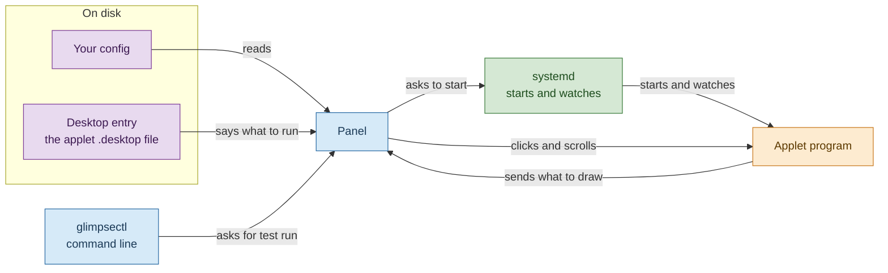
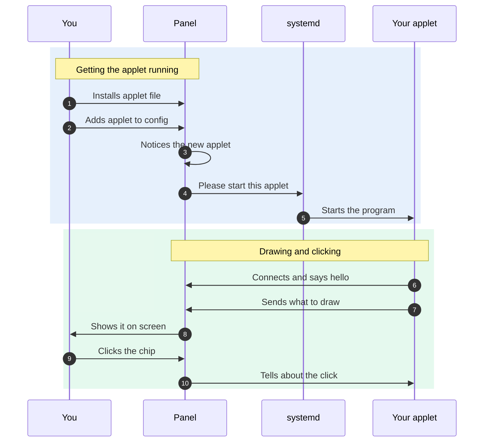
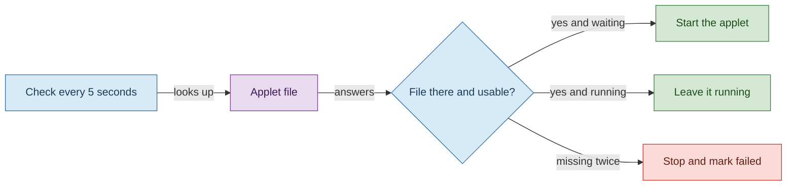
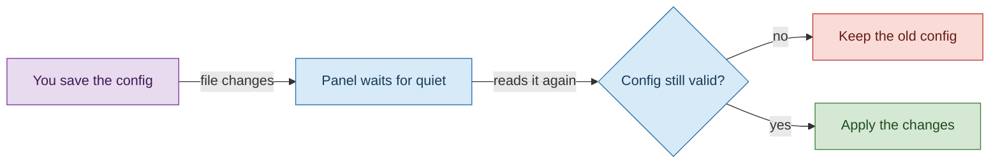
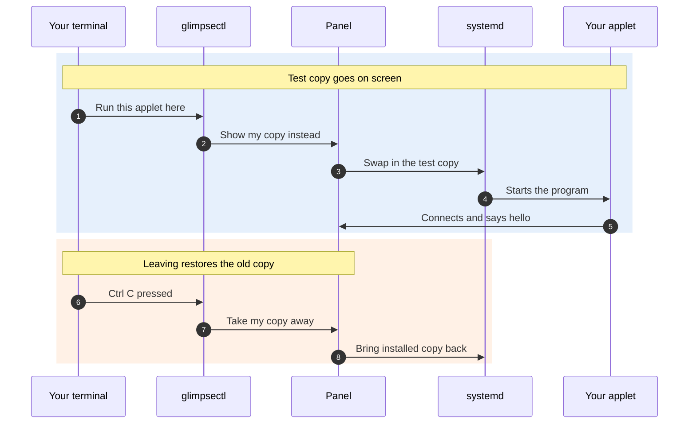
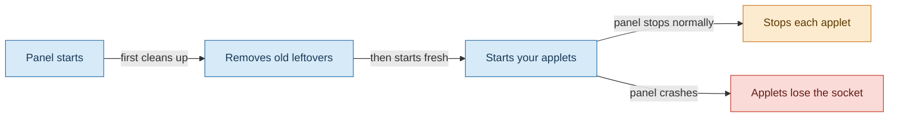

# How exec applets work

An exec applet is a small program you install. It tells the panel what to draw in the bar, and the panel draws it and sends back your clicks and scrolls. The applet never draws anything itself.

## The big picture

| Part           | What it is                                                                                                           | Where in the code                                                                     |
| -------------- | -------------------------------------------------------------------------------------------------------------------- | ------------------------------------------------------------------------------------- |
| Panel          | The bar on your screen. It draws every applet and owns the real widgets.                                             | `crates/glimpse-panel/`, host service in `crates/glimpse-services/src/services/exec/` |
| Applet program | A separate program per place in the bar. It sends descriptions of what to draw.                                      | Written with `sdk/sdk-ts/`                                                            |
| systemd        | The system program that starts other programs and watches them. It starts each applet and restarts it after a crash. | Driven from `crates/glimpse-services/src/services/exec/launcher.rs`                   |
| Desktop entry  | The applet `.desktop` file. It gives the applet a name and says which program to run.                                | Read by `crates/glimpse-services/src/services/exec/catalog.rs`                        |
| Your config    | Your `config.toml`. It says which applets sit in the bar and where.                                                  | Loaded by `crates/glimpse-config/`                                                    |
| `glimpsectl`   | The command line tool. You use it to test an applet you are writing.                                                 | `crates/glimpsectl/`                                                                  |
| Socket         | A private pipe between the panel and one applet. All drawing descriptions and clicks travel through it.              | Opened in `crates/glimpse-services/src/services/exec/mod.rs`                          |
| Unit           | systemd word for one running program it looks after. Each applet start gets its own unit.                            | `crates/glimpse-services/src/services/exec/launcher.rs`                               |
| Slot           | One place in one bar where an applet sits. One slot means one unit, one socket and one drawing.                      | `crates/glimpse-services/src/services/exec/mod.rs`                                    |
| D-Bus          | A message system programs use to ask each other for things. The panel uses it to ask systemd to start applets.       | `crates/glimpse-dbus/`                                                                |

Read the colors as owners. Blue is glimpse code, orange is your applet, green is systemd, and purple sits on disk. When something breaks, the first question is which color owns it.

Two bars showing the same applet are two slots, so the applet program runs twice. A slot also knows where it sits: which screen, which edge of the screen, and which zone of the bar (`left`, `center` or `right`). The applet hears about that place, but it never gets to choose it.

## Follow one applet from install to screen

The same steps with the real names:

1. You install a `.desktop` file whose `Implements` key lists `me.aresa.Glimpse.Applet1`. glimpse keeps no applet registry of its own, so that file is the whole sign up.
2. You put the desktop file id in a bar zone in `config.toml`. A table of the same name can hold `options` and `env` for it. See the [applet configuration pages](/config/applets/).
3. The panel attaches a slot for that place in the bar. The catalog resolves the id to a program to run, and refuses entries it cannot run, for example a hidden entry or one with no `Exec`.
4. The panel opens the slot socket, then asks the systemd user manager over D-Bus to start a transient unit (`StartTransientUnit`). The socket path travels in `GLIMPSE_APPLET_SOCKET`.
5. systemd starts the applet program as that unit. systemd owns the process from here on, including its logs and its restarts.
6. The applet connects to the socket and sends `hello`. The panel answers with its own `hello`, carrying the instance name, the state directory, the current `options` and the placement.
7. The applet sends a `commit`, a batch of changes that describes what to draw. The wire format is [Applet protocol](/developers/protocol).
8. The panel checks the whole batch, then draws it. A batch with one bad change draws nothing at all.
9. You click or scroll on the chip in the bar.
10. The panel sends an `event` to the applet, and the applet answers with a new `commit` if the drawing should change.

Each `hello` starts a new generation. The panel stamps every `event` with the generation of the drawing it came from and drops events from an older generation. A click sent while an applet was restarting can never land on the new drawing by mistake.

The panel resolves `Exec` without a shell. It splits the line with shell style quoting, drops file and URL codes because an applet takes no arguments from the host, and runs the program it finds on `PATH`. The environment for each start is built fresh from the panel environment, the socket path and your configured `env`, so a configured `PATH` decides which program runs.

## How does the panel notice a new applet?

In short:

- The panel does not watch applet files. It asks about them every 5 seconds, and only for applets your config already places in a bar.
- Installing the file for a placed applet that failed makes it start on a later check. An applet with no place in your config gets no slot and never starts.
- A changed file leaves a running applet alone. The new file takes effect the next time that applet starts fresh.
- A file missing on two checks in a row stops the running applet and marks the slot failed.

The check retries a failed slot only when the entry changed, a refusal cleared, or the earlier start itself failed. Listing applets asks the catalog at once, so a new applet shows in lists before its first check runs.

## What happens when you edit your config?

In short:

- One editor save can look like several file changes, so the panel waits for 250 ms of quiet, then reads the config once. `SIGHUP` asks for the same reread.
- A broken edit changes nothing. The panel keeps the last good config and the bar stays as it was.
- Applets started from the command line for testing ignore config edits. Their caller stays in charge of them.

| Change                                 | What happens                                                                                                    |
| -------------------------------------- | --------------------------------------------------------------------------------------------------------------- |
| Applet added to or removed from a zone | A slot attaches or detaches. Detaching stops its unit, and attaching starts a fresh unit with an empty drawing. |
| Applet id or `env` changes             | The slot starts a fresh unit, because the program or its environment is now different.                          |
| `options` change on a running applet   | The panel sends an `options` message. The program keeps running.                                                |
| `options` change on a failed applet    | The slot starts a fresh unit.                                                                                   |
| Bar moves to another edge or screen    | The panel sends a `placement` message. Moving between zones makes a new slot instead.                           |

## What does glimpsectl applet run do?

You run this while writing an applet. Your test copy goes on screen at once, your terminal shows its logs, and nothing about your config changes.

The same steps with the real names:

1. You run `glimpsectl applet run` in a terminal, with a folder or an installed applet id.
2. `glimpsectl` calls `Attach` on the panel interface `me.aresa.Glimpse.AppletHost1`. It passes the desktop file, the panel and screen, optional `options` and `env`, and a pipe for the applet logs.
3. The panel checks the desktop file the same way it checks installed applets. When the same applet already sits in that place on that screen, the test copy takes over its slot and the installed copy stops.
4. systemd starts the test copy as its own unit (`StartTransientUnit`). `glimpsectl` never starts the program itself. The pipe from step 2 becomes the unit stderr, which is why logs land in your terminal and not in the journal.
5. The applet connects to its slot socket and says `hello`, and drawing and clicking work as in the story above.
6. You press Ctrl C in the terminal.
7. `glimpsectl` calls `Detach`. The panel also detaches on its own when the caller leaves the session bus, so closing the terminal cannot strand a test copy.
8. The panel stops the test unit. If an installed copy held that slot, the configured applet starts again in its place.

In short:

- systemd starts the process in both the normal and the test path. Only the caller differs.
- While you test, the installed copy of the same applet in the same place is off screen. Ctrl C brings it back.
- With no matching slot, the test copy gets its own place in the zone you asked for, the zone your config gives that applet, or the right zone.
- A test copy that crashes stays down. Configured applets restart on their own and test copies do not, because you are there watching.

The panel reply to `Attach` means the slot is attached, not that the program is ready. The host accepts at most 8 attachments per caller and 16 in total.

With `--dev`, saving files drives the running test copy. Edits settle for 300 ms first.

| You edit                   | Panel call              | What happens                                                  |
| -------------------------- | ----------------------- | ------------------------------------------------------------- |
| Source files               | `Restart`               | A fresh test unit starts. The terminal key `r` does the same. |
| Options                    | `SetOptions`            | The running applet gets live `options`.                       |
| `env` or the desktop entry | `Detach`, then `Attach` | The panel checks the entry again and replaces the unit.       |

For a folder target, `--dev` watches sources in that folder except hidden paths, `node_modules`, `build` and `dist`. For an installed id it watches the desktop entry and the applet config. The terminal key `t` prints the current drawing (`Tree`). `applet check --run` is a separate headless check where the command line tool starts the child itself and gives it a socket.

## What happens at panel start and exit?

In short:

- A panel that died can leave applet units and socket files behind. Every panel start removes socket files whose owner is gone and asks systemd to stop units left by an earlier panel, before it starts anything.
- A clean panel stop stops each applet unit and removes its socket.
- A panel crash closes the sockets. Applets built with the SDK exit when their socket closes, and the next panel start collects anything left behind.

## When an applet sends too much or breaks the rules

The panel protects the bar first. Small excesses slow one applet down, and protocol abuse stops that one applet. The rest of the bar carries on either way. What happens after a stop, and when the applet comes back, is in [Trust model](/developers/trust#what-happens-when-an-applet-crashes).

Slowed down or dropped, with the applet left running:

- Lines past 120 per second wait. The panel stops reading until the next second, so a chatty applet blocks on its own socket.
- Notifications past one per second, and media player or compositor requests past ten per second, are dropped with a warning.
- Clipboard copies over 1 MiB are dropped. A player id or workspace name over 256 bytes is dropped with a warning.
- A message with an unknown type is ignored. That is what lets a newer SDK talk to an older panel.

Stopped at once, because the panel cannot trust what arrives:

- A line that is not valid protocol JSON, or a line past the 1 MiB cap.
- An unsupported protocol version in `hello`.
- A `commit` or any other request before `hello`.
- A `commit` the tree checker rejects.
- More than 5 `hello` messages within 10 seconds.
- A full outgoing queue, which means the applet stopped reading its socket.

Without a systemd user manager on the session bus, every slot fails with "needs the systemd user manager" and the panel keeps running. Exec applets are the one glimpse feature that cannot work without systemd, and they are the only part that stops.
