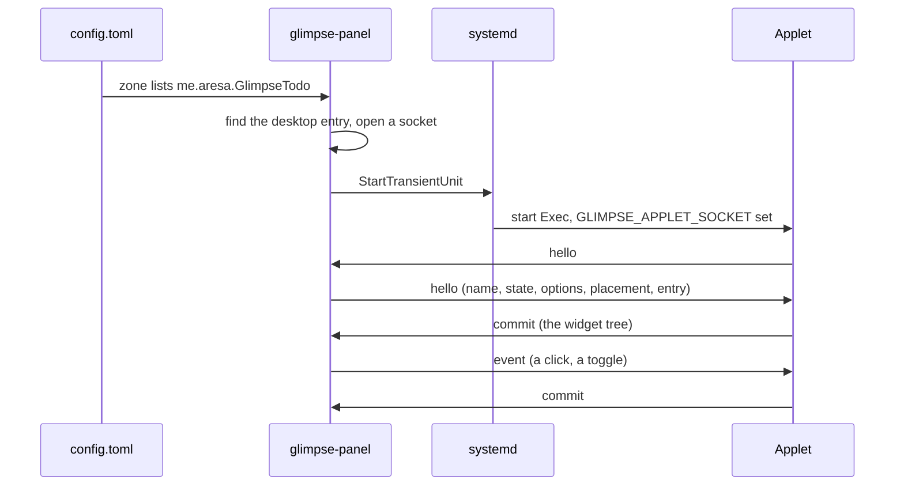

# How an applet runs

An exec applet is a program that describes widgets; the panel draws them and sends back clicks.
This page follows one applet from your config to the screen. The message format is in
[Applet protocol](/developers/protocol).

## From config to process

1. A panel zone names the applet by its desktop-file id, or by a name whose
   `[applets."name"]` table has `extends = "exec"` and `applet = "<id>"`. See
   [Configure an applet in the panel](/applets/exec/configure).
2. The panel finds `<id>.desktop` in the application directories. The entry must list
   `me.aresa.Glimpse.Applet1` in `Implements` and have an `Exec`. glimpse keeps no other registry.
3. The panel resolves `Exec` without a shell. A bare program name is looked up on `PATH`; a
   relative path such as `./todo` resolves against the entry's `Path`, which
   `glimpsectl applet install` sets. An entry attached with `glimpsectl applet run` falls back to
   the directory of its desktop file. That directory is also the working directory.
4. The panel creates a socket under `$XDG_RUNTIME_DIR/glimpse/` and asks the systemd user manager
   to start a transient unit named `app-glimpse-<panel>-<applet>-<slot>-<pid>-<n>.service`. The
   unit gets the panel's environment, your `env`, and `GLIMPSE_APPLET_SOCKET`.
5. The applet connects, says `hello`, and the panel answers with the instance name, its state
   directory (`~/.local/state/glimpse/applets/<id>/`, mode 0700), the options, the bar placement
   and the desktop entry's id, name and icon.
6. From then on the applet sends `commit`s and the panel sends `event`s. The panel checks every
   commit as a whole and draws nothing from a bad one.

The SDKs do steps 5 and 6 for you. Stderr goes to the journal.

## One process, several bars

Each configured instance runs once per placement. Two bars at the same edge, orientation, zone and
size share one process, even on different screens: the applet draws once and both bars show it. A
bar with a different placement starts its own process, so a vertical bar never gets a layout made
for a horizontal one.

Give an applet two instances when you want two different configurations. Each instance is its own
process with its own options.

## When something changes

| Change | What happens |
| --- | --- |
| `options` | The panel sends an `options` message. The process keeps running. |
| `env` or the applet id | The unit stops and a new one starts. |
| The desktop entry | A running applet keeps going, and systemd restarts it with the command it started with. The new entry takes effect when the panel starts a new unit: after an `env` or id change, a placement split, or a failure. A failed applet starts again. |
| The bar moves to another edge or size | The panel sends a `placement` message. A bar whose placement now differs from the bars it shared a process with starts its own. |
| The applet is removed from every zone | The unit stops. |

The panel watches the `applications` folders for placed applets' entries. An applet that failed
because its entry was missing starts as soon as the entry appears; a running applet whose entry is
gone and still missing a second later stops. An applet that failed to launch for another reason
tries again after 5 seconds.

## When it exits

systemd restarts an applet whenever it exits: after 1 second the first time, backing off to
60 seconds, with no limit on attempts. An applet that stays up for 60 seconds starts the backoff
over. The panel kills the unit when the applet breaks the protocol, and the same restart follows;
the reasons are in [What an applet can do](/developers/trust).

Each `hello` starts a new generation. Clicks sent to an applet that has since restarted are
dropped, so they never land on the new widget tree.

When the panel exits, it stops every applet unit. If it crashes, the applets lose their socket and
exit; systemd keeps restarting them with backoff until the next panel start stops every leftover
unit.
