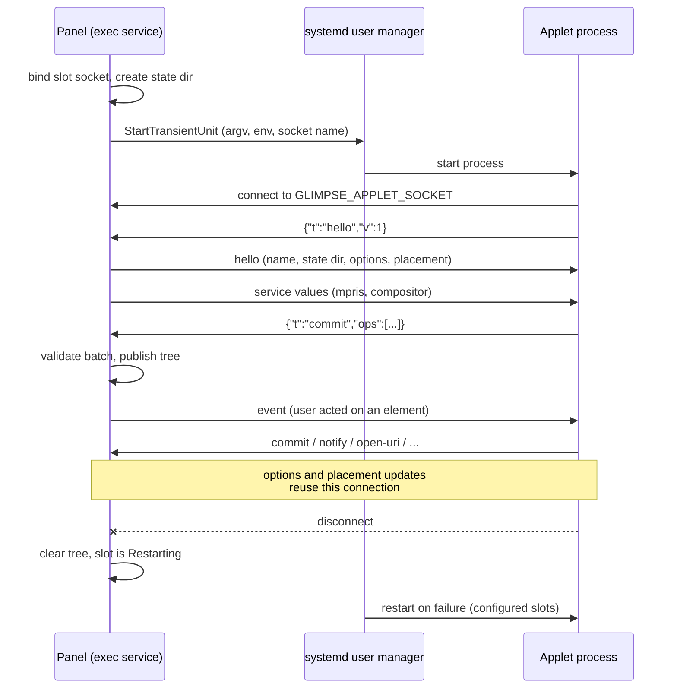

# How exec applets work

An exec applet is a separate program that draws one chip in the bar and, usually, one popover. The panel
is the host: it finds the applet through a desktop entry, starts it as a systemd user unit, and exchanges
newline-delimited JSON with it over a unix socket. The applet describes a small widget tree; the panel
owns the real widgets. This page explains the host's side of that arrangement as the current code
implements it. The wire format itself is [Applet protocol](/developers/protocol), and the trust boundary
(or lack of one) is [Trust model](/developers/trust).

## Discovery through desktop entries

There is no applet registry of glimpse's own. An applet ships a desktop entry whose `Implements` key
lists `me.aresa.Glimpse.Applet1`, and the whole catalog is answered by asking the desktop-entry system
which entries implement that interface. Listing applets is that query, sorted by id.

Resolving one id loads `<id>.desktop` and then applies glimpse's own checks. An entry is refused, with
the reason kept for display, when it is hidden, when `Implements` does not include the interface, when it
is `DBusActivatable` or `Terminal` (neither can speak the socket protocol), or when it has no `Exec`. An
entry whose `TryExec` or `Exec` program is not on `PATH` does not load at all. What survives becomes an
argv: `Exec` is split with shell-style quoting rules but no shell ever runs, file and URL field codes
(`%f`, `%u` and friends) are dropped because an applet takes no arguments from the host, `%i` becomes
`--icon` plus the icon name, `%c` the entry name, `%k` the desktop file's path, and an unknown field code
refuses the entry. The working directory is the entry's `Path`, or the desktop file's own directory.

Configuration names applets by putting the desktop-file id in a bar zone, optionally with a table of the
same name holding `options` and `env`. A second instance of the same applet is a named table extending
`exec`. The details are user-facing and live in the [applet configuration pages](/config/applets/).

## Slots and zones

Inside the panel, each placed exec applet instance on one bar is a slot, identified by a number the panel
assigns when it attaches the applet to a zone (`left`, `center` or `right`, on one output). The slot is
the unit of everything that follows: one systemd unit, one socket, one widget tree, one generation. Two bars showing the same applet are two slots and two processes. The slot also carries the
placement the applet is told about: output connector, bar edge, orientation, zone and bar thickness.

Attachment is the panel's job, config the exec service's job. When the panel builds a bar, it attaches
each exec applet's slot with its configured name and placement; the exec service looks the name up in the
configuration it holds to find the desktop id, `options` and `env`. A slot whose name is not configured
is a failed slot, not an error for the panel: the bar builds without it.

## Each start is a transient unit

The exec service never forks an applet. Every start asks the systemd user manager, over the session bus,
to start a transient service unit named:

```
app-glimpse-<panel>-<applet>-<slot>-<panel pid>-<n>.service
```

The panel component is the panel's application id, the applet component is the desktop id, and a dash in
either is escaped so the fields stay separable. The counter `n` increases on every deliberate restart, so
a replaced applet never collides with its predecessor's unit. The unit's description is the entry's name,
its slice is `app.slice`, and it is collected once inactive or failed.

systemd, not the panel, owns the process from this point: its cgroup, its journal (an applet's stderr
goes there), a `MemoryMax` of 256 MiB, and a restart curve for configured applets: restart on failure
after 1 second, in 6 steps up to a 60 second delay, with no start limit. The environment is built fresh
for each start: the panel's environment with the systemd-internal names filtered out, then
`GLIMPSE_APPLET_SOCKET`, then the configured `env` entries (also filtered). The first argv element is
resolved against that merged environment's `PATH`, so a configured `PATH` decides which program runs.
Before the start, the applet's persistent state directory is created (mode 0700) so its path can be handed
to the applet in the `hello` reply.

Without a systemd user manager on the session bus, every slot fails with the reason "needs the systemd
user manager" and the panel keeps running. Exec applets are the one glimpse feature with a hard systemd
dependency, and its absence degrades exactly those slots.

## The per-slot socket

Before starting the unit, the host binds a unix socket for the slot under the glimpse runtime directory
(`$XDG_RUNTIME_DIR/glimpse/applets/<panel pid>-<slot>.sock`) and names it in `GLIMPSE_APPLET_SOCKET`. A
stale file at that path is removed first. The socket serves one connection at a time: a second connection
while one is live is accepted and dropped, and after a disconnect the host listens again on the same
socket for the unit's next incarnation. The applet speaks first and the host sends nothing until it has
read `hello`.



## Hello and generations

Each `hello` (the first on a connection, or a later one from the same process after a reload) starts a
new generation: the host advances a generation counter, clears the slot's tree, marks the slot running,
and answers with its own `hello` carrying the instance name, the state directory, the current options and
the current placement. It then replays the current popover state and the cached media-player and
compositor values, so a reloaded applet starts from the present, not from nothing.

Generations exist to solve the stale-event problem. User events from the panel carry the generation of
the tree they were produced against, and the exec service drops any event whose generation is not the
slot's current one. A click that was in flight while an applet reloaded cannot reach the new incarnation
as if it belonged to the new tree.

## The reconciled tree

The applet never touches GTK. It sends commits: batches of insert, move, remove and set operations. The
host applies a batch to a copy of the slot's tree, checks ids, cycles, the parent table and the size caps
against the whole batch, and only then swaps the copy in as the published tree. A rejected batch changes
nothing on screen (and, as below, costs the applet its unit). The panel's exec widget renders whatever
tree is published and turns user gestures into protocol events. Requests in the other direction
(notifications, clipboard copies, URIs, workspace and player control) are handled by the exec service
against the panel's own services, under the caps in [Trust model](/developers/trust).

## Updates without a restart

Two kinds of change are delivered over the live connection rather than by restarting the process:

- An options change. Saving a different `options` table, or a dev client calling `set_options`, sends an
  `options` message with the new object. The process keeps running and decides what to redraw.
- A placement change. When the bar moves edge, output or thickness and the slot moves with it, a
  `placement` message carries the new placement. Zone changes are not a placement update: a different
  zone is a different slot, attached fresh.

## Restarts and environment changes

Everything that defines the process itself does restart it. On a configuration reload, if a slot's
desktop id or its `env` changed, the host cancels the slot's connection and spawn, and starts the next
unit (the next `n` in the name) with the new values and an empty tree. An options change for a slot that
is currently failed also restarts it, since there is no live process to deliver the message to, while an
applet removed from the configuration has its connection and unit stopped and its slot marked failed.

The desktop entry is watched the same way. While any configured slot is running or failed, the host
re-resolves its entry every 5 seconds. A failed slot restarts when its entry resolves again, changed, or
when the previous failure was at launch: this is what makes installing or fixing an applet on disk take
effect without touching the panel. A running applet whose entry stops resolving is left alone until the
catalog has missed it twice, then its unit is stopped and the slot fails with the catalog's reason.

## Startup sweep and shutdown

A panel that died without stopping its applets leaves two things behind: transient units and socket
files. So every panel startup sweeps before it starts any slot. It deletes socket files whose owning process
has exited, and asks the user manager to stop every unit matching its own prefix
(`app-glimpse-<panel>-*`), which catches the previous incarnation's applets whatever pid they carried.

A clean panel stop stops each slot's unit and removes its socket. A crashed panel does neither, but its
exit closes the sockets, and an applet whose socket reaches the end of the stream has nothing left to do;
the sweep at the next startup collects any unit still lingering.

## Dev slots

`glimpsectl applets run` attaches a dev slot through the panel's `me.aresa.Glimpse.AppletHost1` interface
rather than through configuration. The caller passes an absolute desktop-file path, a panel and output, an
optional zone, options and environment, and a file descriptor that becomes the unit's stderr, which is
why a dev applet's logs land in the terminal instead of the journal. The host validates the path (it must
be a regular `.desktop` file whose stem is a valid desktop id), resolves it through the same catalog
checks as an installed applet, and admits at most 8 attachments per bus sender and 16 in total.

A dev slot whose desktop id matches a configured applet on the same output takes that applet's slot over
in place; otherwise it waits, and enters its zone (the configured zone for that id if there is one, else
the right zone) when the bar next reconciles. Dev units are started with restarts disabled: a crashed dev
applet stays down until the caller restarts it, and `glimpsectl applets run --dev` does exactly that on
source edits, while also pushing options changes live. Detaching (which also happens automatically when
the caller's bus name vanishes, as it does on Ctrl-C) hands a taken-over slot back to the configured
applet, which restarts as a fresh unit.

## Rates, crashes and what kills a unit

Not every excess is fatal. The host counts lines per second; past 120 it simply stops reading until the
next second, so a chatty applet blocks on its own socket. Notifications past one per second and
media-player or compositor calls past ten per second are dropped with a warning. Clipboard copies over
1 MiB are dropped silently; a player id or workspace name over 256 bytes is dropped with a warning.

A crash is systemd's business. The host watches each unit's state: entering an auto-restart is reported
as the slot restarting with its restart count, a failed unit fails the slot with the unit's result, and a
unit that disappears ends the slot. On any disconnect the published tree is cleared, so the bar never
keeps drawing a dead applet's last frame. A unit that then runs cleanly for 60 seconds has its failed
state reset and its restart count forgiven.

The host itself kills a unit (a `KillUnit` of all its processes, signal 9) only for protocol abuse:

- a line that is not valid protocol JSON, or a line past the 1 MiB cap
- an unsupported protocol version in `hello`
- a commit or any other request before `hello`
- a commit the tree validator rejects
- more than 5 `hello`s within 10 seconds
- a full outgoing queue: the applet has stopped reading its socket

A message with an unknown type is explicitly not on this list; it is ignored, which is what lets a newer
SDK talk to an older host. A killed configured applet restarts under systemd's restart curve like any
crashed one, and only the offending slot is affected. Everything else in the bar carries on.
