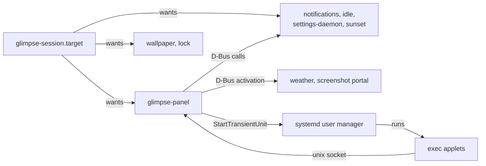

# How glimpse fits together

glimpse is a set of small programs, each a systemd user service with one job. They read one config
file and talk over the session bus. Exec applets are separate programs that the panel starts for
you.

## Who owns what

- Each program owns its own state. Nothing else writes it; others ask over D-Bus.
- The panel starts no applet process itself. Every exec applet is a transient systemd unit, so
  systemd owns its process, restarts, memory limit and logs.
- The config file is the only configuration. Every program reloads its part when the file changes.

[How an applet runs](/developers/exec-applets) follows one applet from config to screen.
[systemd and D-Bus](/developers/systemd) lists the units, bus names and the applet host interface.
