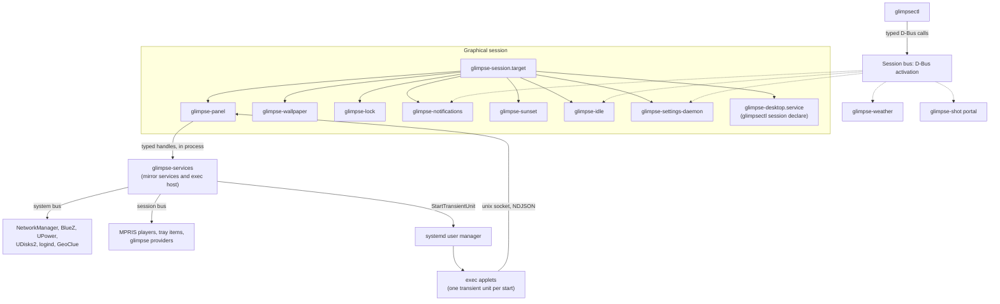

# Architecture

glimpse is not one shell process. It is a set of small binaries, plus a library layer they share. Each
long-lived binary owns one surface or one provider name, reads the same configuration file, and talks to
the others over D-Bus or through typed handles in its own process. Splitting the shell this way means a
panel restart does not blank the wallpaper, a dead weather provider does not take notifications with it,
and the lock screen depends on no other glimpse process at all.

## The binaries

| Binary | Owns | Session-bus name |
| --- | --- | --- |
| `glimpse-panel` | The layer-shell bars, built-in applets and popovers, the exec-applet host service, and the clipboard history provider. Most services run as tasks inside this process (see below). | Application id `me.aresa.GlimpsePanel` by default, plus `me.aresa.Glimpse.Clipboard` and the applet host name derived from the application id |
| `glimpse-wallpaper` | One background layer surface per output, image decoding and transitions. It is a separate binary so that restarting the panel does not black the screen, and it depends on no other glimpse process. | Application id `me.aresa.GlimpseWallpaper`; no provider interface |
| `glimpse-lock` | The lock screen: session-lock surfaces and PAM authentication. Its own page is [How the lock screen works](/developers/lock-screen). | Application id `me.aresa.GlimpseLock`; no provider interface. It calls logind on the system bus |
| `glimpse-notifications` | Notification history, the transient popup stack, and the provider other glimpse processes post through. A process that cannot take its provider name exits, because a popup surface with no name serves nothing. | `me.aresa.Glimpse.Notifications`, `org.freedesktop.Notifications` when the in-process server can take it, and the application id `me.aresa.GlimpseNotifications` |
| `glimpse-weather` | Weather fetching. Places are leased by consumers for 30 minutes at a time, so with no lease the provider fetches nothing. "Here" follows the settings daemon's geolocation; this process acquires no location itself. | `me.aresa.Glimpse.Weather` |
| `glimpse-sunset` | Night light: it follows the settings daemon's solar phase and applies a color temperature to every output through the compositor's gamma control. It runs no solar calculation of its own. | `me.aresa.Glimpse.NightLight` |
| `glimpse-idle` | Idle listeners driven by the compositor's idle notifications, the inhibitor registry behind the idle applet, the screensaver inhibit surface, and the portal inhibit backend. | `me.aresa.Glimpse.Idle` and `me.aresa.Glimpse.Idle.Portal`, plus `org.freedesktop.ScreenSaver` (non-fatal if taken) |
| `glimpse-settings-daemon` | Geolocation, the solar phase computed from it, and the desktop light and dark mode. Sunset and the weather provider are its followers, so exactly one process acquires a location and one process calculates sunrise and sunset. | `me.aresa.Glimpse.Settings` |
| `glimpse-shot` (portal mode) | The screenshot portal backend, run as `glimpse-shot portal`. The same binary is the screenshot application; the portal mode never constructs that application. | `me.aresa.Glimpse.Shot.Portal` (the application itself is `me.aresa.Glimpse.Shot`) |
| `glimpsectl` | The command line. Each command is one typed operation on one provider, or a read of the configuration stack from disk. Its hidden `session declare` entry point is also what `glimpse-desktop.service` runs. | None; it is a client |

Two pattern rules explain the shape. A binary crate is a leaf that nothing else depends on, and shared
code lives underneath: `glimpse-dbus` holds the D-Bus proxies, `glimpse-config` owns file locations and
the configuration stack, `glimpse-services` holds the service framework and the service implementations,
`glimpse-compositors` speaks to the compositor, and `glimpse-widgets` holds shared GTK widgets. The
dependency order is one-way, for example `glimpse-services` depends on `glimpse-dbus` and never the
reverse, and the services crate has no Wayland dependency: a service reaches a compositor through traits
(whose implementations live in the binary that needs them) and the compositor IPC crate.

## How they start

`glimpse-session.target` is wanted by `graphical-session.target` and wants the panel, wallpaper, sunset,
notifications, idle, lock, settings-daemon and desktop units. That covers everything the session needs
from the start. Two providers are deliberately not in that list, because nothing needs them until a
consumer asks:

- `glimpse-weather.service` and `glimpse-shot-portal.service` are started by D-Bus activation. Their
  service files in `data/dbus-1/services` name both an `Exec` and a `SystemdService`, so the first call
  to the bus name starts the unit. The idle, notifications and settings units also have activation files,
  as a way back in if they were stopped.
- The night-light unit has no activation file on purpose. An activation outside a graphical session
  would fail every time, and enough failures inside the start-limit interval would fail the unit for the
  rest of the session.

`glimpse-desktop.service` is a one-shot that runs `glimpsectl session declare`. When
`XDG_CURRENT_DESKTOP` is exactly `niri`, it sets `glimpse:niri` in the systemd and D-Bus activation
environments and try-restarts `xdg-desktop-portal.service`, so portal backend selection and other
`XDG_CURRENT_DESKTOP` checks see glimpse. Any other identity is left alone. It is
ordered before `graphical-session.target` and `xdg-desktop-autostart.target` so the identity is in place
before autostart entries run.

The full unit and name inventory is the reference page
[Installed files](/developers/files).

## How they talk

There are four channels, each with a clear owner:

- Inside one process, a service is one Tokio task with typed state and typed commands. Consumers hold
  cloneable handles giving a snapshot, a watch receiver, health and command methods. A built-in applet
  renders those snapshots and sends those commands; it never opens a D-Bus connection and never reaches
  a backend directly. There is no string-routed broker.
- Between glimpse processes, the session bus carries the provider interfaces: `me.aresa.Glimpse.Weather1`,
  `me.aresa.Glimpse.NightLight1`, `me.aresa.Glimpse.Notifications1`, `me.aresa.Glimpse.Idle1`,
  `me.aresa.Glimpse.Settings1`, `me.aresa.Glimpse.Clipboard1` and `me.aresa.Glimpse.AppletHost1`. A
  provider exports its object before it requests its name, and takes the name with a do-not-queue
  request, so a duplicate owner fails instead of stealing the name. Clients usually run as "followers"
  that track the name's owner and decode its snapshot property once for every consumer in the process.
- To system backends, services use the system bus (NetworkManager, BlueZ, UPower, UDisks2, logind,
  GeoClue, power-profiles-daemon) and a few non-bus sources such as PulseAudio, sysfs backlights and the
  compositor's IPC socket. glimpse never shells out to tools such as `systemctl` or `nmcli`, because a
  subprocess cannot be mocked and its output is not a stable interface. The systemd user manager itself
  is driven through its D-Bus API on the session bus, which is how exec applets are started (see
  [How exec applets work](/developers/exec-applets)).
- To exec applets, the panel speaks newline-delimited JSON over a per-slot unix socket. That wire format
  has its own reference page, [Applet protocol](/developers/protocol).

## Mirror services

Most services inside the panel are mirrors: network, bluetooth, audio, battery, MPRIS, brightness,
removable media, tray, KDE Connect, the compositor and the keyboard layouts. A mirror enumerates its
backend once at start, then follows change signals. It adds no policy of its own: no auto-connect rules,
no reconnect loops, no retry logic on top of a backend that already makes those decisions. Commands are
thin pass-throughs, and when the mirror and the backend disagree, the backend is right.

This keeps the panel honest and small, but it also means the state an applet shows can lag or correct
itself when a signal arrives. The few places where glimpse does add a decision on top of a backend are
named, one by one, in [Design principles](/developers/principles).

## Configuration load and reload

There is one document, `config.toml`, with a top-level table per owner. Loading merges a fixed layer
stack: built-in defaults, `/etc/glimpse/config.toml`, system drop-ins, the user's `config.toml`, user
drop-ins, and finally `shot.toml`, which contributes only its screenshot table. Tables merge per key;
scalars and arrays replace. A `--config` path replaces the middle layers with that one file. Every
long-lived binary validates the whole document, then acts on only the tables it owns. A file that exists
and is wrong fails the load, but no configuration error stops a daemon: a binary starts from defaults,
or drops a bad reload and keeps the last good document, and only the panel turns the problem into a
notification so one broken file makes one notification.

Each binary watches the directories of its layer stack itself and also reloads on `SIGHUP`, which is what
each unit's `ExecReload` sends. Watches sit on directories rather than files so that creating a drop-in
is noticed, and events are coalesced over 250 ms of quiet because one editor save is often a write and a
rename. `glimpse-session.target` propagates a reload to the panel, wallpaper, sunset, notifications,
idle and settings-daemon units, so reloading the target reloads the shell. One deliberate exception sits
in the locker: its PAM service name is read once at start and a later change is ignored until restart,
because repointing it during a lock could point authentication at a stack that always succeeds.

The settings themselves are documented under [Configuration](/config/).
