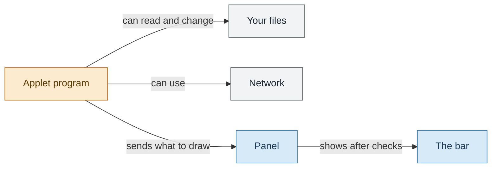
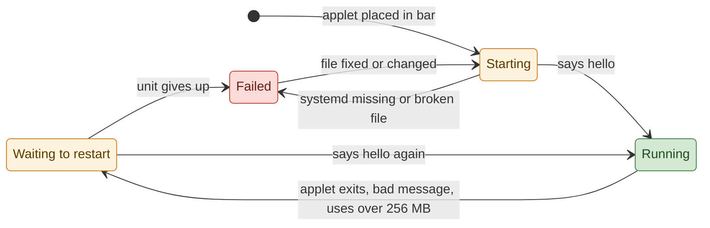

# Trust model

An exec applet runs as a transient systemd user unit with the user's full session. Installation is the
trust decision; the host's protocol checks protect the panel without confining the process.

## What can an applet reach?

In short:

- An applet runs as you. It can reach your files, the network and the session bus without asking the panel for anything.
- The panel checks only what arrives through the applet socket, so one applet cannot flood or break the bar for the others.
- Installing an applet is the trust decision, as installing any program is.

## What an applet can do

The unit gets the panel's environment plus any `env` entries from its configuration table. It can reach the session bus, the user's files, the
network and everything else the user can reach. Its persistent state directory is mode 0700, but that is
housekeeping, not a boundary: nothing stops an applet from reading or writing anywhere else the user can.

Installing an applet is therefore the trust decision, exactly as installing any application is. The
desktop entry decides what runs, and glimpse refuses entries it cannot run honestly, but it does not audit
what the program does once started. A malicious applet needs nothing from the panel to do damage: it
already runs as the user.

## What happens when an applet crashes?

One slot moves through four states. The panel watches two things to move it: the socket handshake and the systemd unit state.

In short:

- A crash costs one slot its chip for a short wait. Everything else in the bar carries on.
- Configured applets come back on their own. Test copies from `glimpsectl applet run` stay down until you restart them.
- A failed slot waits for a reason to try again, such as a fixed desktop entry. It does not spin.

| Cause                             | What happens                                                                                                                | How long until it comes back                                                                         |
| --------------------------------- | --------------------------------------------------------------------------------------------------------------------------- | ---------------------------------------------------------------------------------------------------- |
| Applet exits with failure         | systemd restarts configured units (`Restart` on failure). Dev units use `Restart=no`.                                       | After 1 s, rising in 6 steps to 60 s, with no start limit. Dev units never restart alone.            |
| Bad message (protocol abuse)      | The host disconnects and kills the unit (`KillUnit`, all processes, signal 9). Only that slot is affected.                  | Configured units follow the same restart curve.                                                      |
| Memory limit reached              | `MemoryMax` of 256 MiB caps the unit cgroup. A process killed for memory counts as a failure.                               | The same restart curve as any other failure.                                                         |
| Socket disconnects, process alive | The panel clears the published tree and listens on the same socket again. A disconnect alone does not restart the process.  | When the process connects and says `hello` again.                                                    |
| Entry or launch fails             | The slot fails with the reason kept for display.                                                                            | Checked every 5 s. It retries when the entry changed, a refusal cleared, or the start itself failed. |
| systemd is missing                | Every slot fails with `needs the systemd user manager`. The panel keeps running.                                            | When a systemd user manager is on the session bus.                                                   |
| Applet runs well for 60 s         | The host calls `ResetFailedUnit` and clears the recorded restart count, so the next crash starts the curve at 1 s again.    | It never left.                                                                                       |
| Panel crashes                     | Sockets close and applet processes see EOF. The SDK exits on EOF, so applets end with the panel.                            | At the next panel start.                                                                             |
| Leftovers after a panel crash     | The next panel start deletes socket files whose owner is gone and stops units left by the earlier panel, then starts fresh. | During that startup, before any applet starts.                                                       |

The waiting state also covers a disconnected dev slot waiting for its caller. When systemd removes a unit, an active slot ends, including after a clean exit, and ended slots do not retry. A slot that already failed stays failed until a check finds a reason above.

## Text from other apps

The same suspicion applies in the other direction. Titles, metadata and names that arrive from tray
items, notifications, media players, windows and wireless networks are treated as hostile input wherever
glimpse displays them, including inside exec applets: media-player fields and window titles are capped at
256 characters before they are sent to an applet, and applet labels render them as plain text. An applet
is trusted code, but the strings flowing through it are not.
